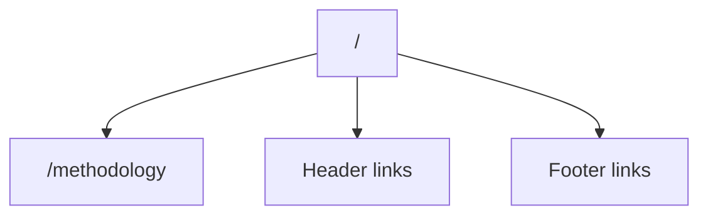
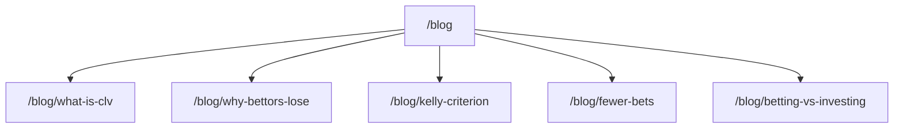
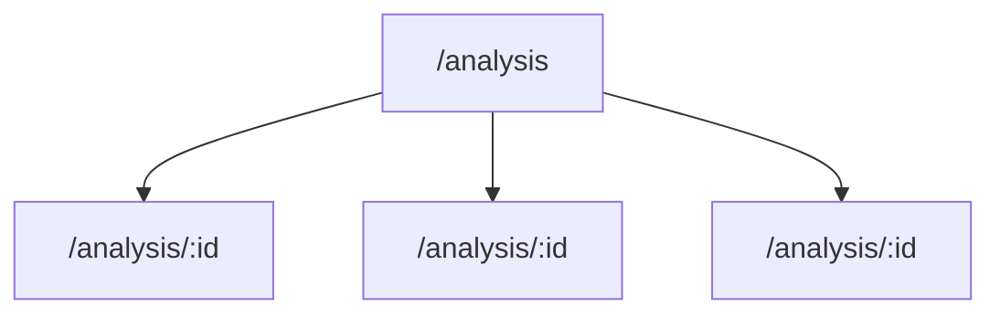

# Doctore AI – Sisäinen Linkkikartta (Sitemap)

> URL-tason navigaatiorakenne ja sivujen väliset linkit

---

## 📍 URL-hierarkia

```
/                           # Landing (etusivu)
├── /dashboard              # Dashboard (pipeline control, ROI, plays)
├── /methodology            # Methodology (edge validation explained)
├── /clv                    # CLV Explained
├── /analysis               # Analysis Index (kaikki edget)
│   └── /analysis/:id       # Analysis Detail (yksittäinen edge)
├── /blog                   # Blog Index
│   ├── /blog/fewer-bets
│   ├── /blog/what-is-clv
│   ├── /blog/kelly-criterion
│   ├── /blog/why-bettors-lose
│   ├── /blog/betting-vs-investing
│   ├── /blog/match-analysis-example
│   ├── /blog/vig-explained
│   └── /blog/match-analysis
├── /pricing                # Pricing
├── /performance            # Performance
├── /edge-detection         # Edge Detection
├── /bankroll-management    # Bankroll Management
├── /responsible-gaming     # Responsible Gaming
├── /terms                  # Terms of Service
├── /sitemap                # Sitemap (interaktiivinen)
└── /*                      # 404 NotFound
```

---

## 🔗 Navigaatiorakenne

### Header (SiteHeader) – Globaali navigaatio

| Label          | URL              | Näkyy |
|----------------|------------------|-------|
| doctore        | `/`              | Logo  |
| Methodology    | `/methodology`   | ✓     |
| Analysis       | `/analysis`      | ✓     |
| Edge Detection | `/edge-detection`| ✓     |
| CLV            | `/clv`           | ✓     |
| Blog           | `/blog`          | ✓     |
| Pricing        | `/pricing`       | ✓     |
| Dashboard      | `/dashboard`     | ✓     |

### Footer (SiteFooter) – Globaali navigaatio

#### Platform
| Label           | URL                    |
|-----------------|------------------------|
| Methodology     | `/methodology`         |
| CLV Explained   | `/clv`                 |
| Edge Detection  | `/edge-detection`      |
| Bankroll        | `/bankroll-management` |

#### Resources
| Label       | URL           |
|-------------|---------------|
| Blog        | `/blog`       |
| Performance | `/performance`|
| Pricing     | `/pricing`    |
| Dashboard   | `/dashboard`  |

#### Legal
| Label              | URL                   |
|--------------------|------------------------|
| Terms              | `/terms`               |
| Responsible Gaming | `/responsible-gaming`  |

#### Social
| Label     | URL                                |
|-----------|------------------------------------|
| Instagram | https://www.instagram.com/doctore_ai/ |

---

## 📄 Sivukohtaiset linkit

### Landing (`/`)



| Linkki                    | Kohde           | Konteksti                |
|---------------------------|-----------------|--------------------------|
| "See methodology"         | `/methodology`  | CTA-osion alapuolella    |
| Header navlinks           | (kaikki header) | Globaali navigaatio      |
| Footer links              | (kaikki footer) | Globaali footer          |

---

### Blog Index (`/blog`)



| Artikkeli                                   | URL                        |
|---------------------------------------------|----------------------------|
| What is Closing Line Value (CLV)?           | `/blog/what-is-clv`        |
| Why most bettors lose despite 'good picks'  | `/blog/why-bettors-lose`   |
| Kelly Criterion explained without hype      | `/blog/kelly-criterion`    |
| Why fewer bets can outperform...            | `/blog/fewer-bets`         |
| Betting vs investing: key differences       | `/blog/betting-vs-investing` |

---

### Analysis Index (`/analysis`)



| Elementti         | Kohde              | Huomio                     |
|-------------------|--------------------|-----------------------------|
| AnalysisCard      | `/analysis/:id`    | Dynaaminen edge-ID          |
| "Open Analysis"   | `/analysis/:id`    | Kortin CTA-painike          |

---

### Analysis Detail (`/analysis/:id`)

| Linkki            | Kohde       | Konteksti               |
|-------------------|-------------|-------------------------|
| Breadcrumb "Back" | `/analysis` | Paluu listaukseen       |
| Header/Footer     | Globaalit   | Standardinavigaatio     |

---

### Dashboard (`/dashboard`)

| Linkki                              | Kohde          | Konteksti               |
|-------------------------------------|----------------|-------------------------|
| "View full performance history →"   | `/performance` | ROI-osion alla          |
| Header/Footer                       | Globaalit      | Standardinavigaatio     |

---

### Pricing (`/pricing`)

| Linkki                    | Kohde           | Konteksti                |
|---------------------------|-----------------|--------------------------|
| "Read the methodology"    | `/methodology`  | CTA-osion alla           |
| "Go to Dashboard →"       | `/dashboard`    | CTA-osion alla           |
| Header/Footer             | Globaalit       | Standardinavigaatio      |

---

### Performance (`/performance`)

| Linkki                    | Kohde           | Konteksti                |
|---------------------------|-----------------|--------------------------|
| "Read the methodology"    | `/methodology`  | CTA-osion alla           |
| "Go to Dashboard →"       | `/dashboard`    | CTA-osion alla           |
| Header/Footer             | Globaalit       | Standardinavigaatio      |

---

## 🗺️ Visuaalinen linkkikartta

```mermaid
graph LR
    subgraph "Global Navigation"
        Header["🔝 Header"]
        Footer["🔻 Footer"]
    end

    subgraph "Main Pages"
        Landing["/"]
        Dashboard["/dashboard"]
        Methodology["/methodology"]
        CLV["/clv"]
        Pricing["/pricing"]
        Performance["/performance"]
        Sitemap["/sitemap"]
    end

    subgraph "Content Hubs"
        Blog["/blog"]
        Analysis["/analysis"]
    end

    subgraph "Blog Articles"
        BlogCLV["/blog/what-is-clv"]
        BlogKelly["/blog/kelly-criterion"]
        BlogFewer["/blog/fewer-bets"]
        BlogWhyLose["/blog/why-bettors-lose"]
        BlogBetting["/blog/betting-vs-investing"]
    end

    subgraph "Educational"
        EdgeDetection["/edge-detection"]
        Bankroll["/bankroll-management"]
    end

    subgraph "Legal"
        Terms["/terms"]
        Responsible["/responsible-gaming"]
    end

    subgraph "Dynamic"
        AnalysisDetail["/analysis/:id"]
    end

    Header --> Landing
    Header --> Methodology
    Header --> Analysis
    Header --> EdgeDetection
    Header --> CLV
    Header --> Blog
    Header --> Pricing
    Header --> Dashboard

    Footer --> Methodology
    Footer --> CLV
    Footer --> EdgeDetection
    Footer --> Bankroll
    Footer --> Blog
    Footer --> Performance
    Footer --> Pricing
    Footer --> Dashboard
    Footer --> Terms
    Footer --> Responsible

    Landing --> Methodology
+    Dashboard --> Performance
+    Pricing --> Dashboard
+    Pricing --> Methodology
+    Performance --> Dashboard
+    Performance --> Methodology
    Blog --> BlogCLV
    Blog --> BlogKelly
    Blog --> BlogFewer
    Blog --> BlogWhyLose
    Blog --> BlogBetting
    Analysis --> AnalysisDetail
```

---

## 📊 Linkkitilastot

| Mittari                      | Arvo |
|------------------------------|------|
| Kokonais-URL:t               | 19   |
| Staattiset sivut             | 16   |
| Dynaamiset reitit            | 1 (`/analysis/:id`) |
| Blog-artikkelit              | 8    |
| Header-linkit                | 7    |
| Footer-linkit                | 10   |
| Ulkoiset linkit              | 1 (Instagram) |

---

## ⚠️ Puuttuvat linkit (tarkistettava)

| Sivu              | Puuttuva linkki                | Status                            |
|-------------------|--------------------------------|-----------------------------------|
| `/methodology`    | ← ei linkkiä `/analysis`:sta   | ✅ KORJATTU                       |
| `/performance`    | ← ei linkkiä dashboardista     | ✅ KORJATTU (ROI-osio)            |
| `/edge-detection` | ← vain footerissa              | ✅ KORJATTU (Header-navigaatio)   |
| Blog articles     | ← ei keskinäisiä linkkejä      | ✅ KORJATTU (Related reading)     |

---

## 🔄 SEO Canonical URLs

| Sivu             | Canonical URL                        |
|------------------|--------------------------------------|
| Landing          | `https://doctore-ai.com/`            |
| Blog             | `https://doctore-ai.com/blog`        |
| Analysis         | `https://doctore-ai.com/analysis`    |
| Analysis Detail  | `https://doctore-ai.com/analysis/:id`|

---

*Päivitetty: 2025-01*