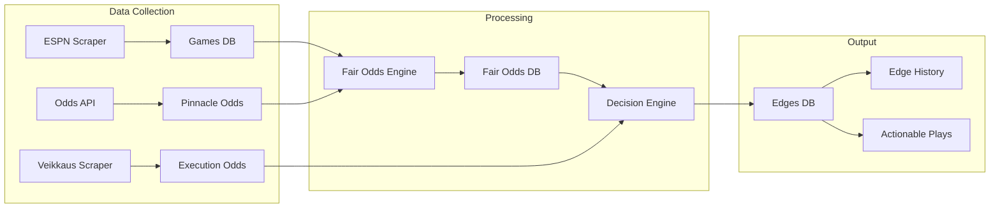
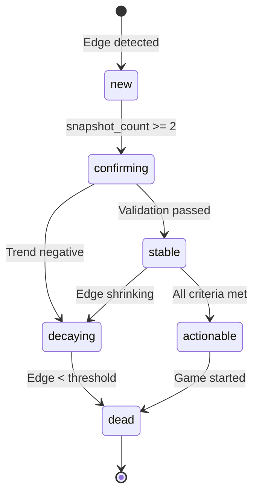
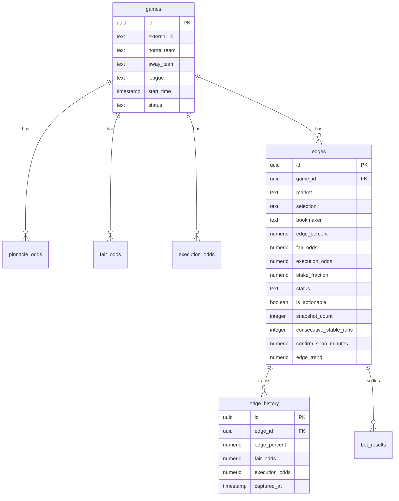
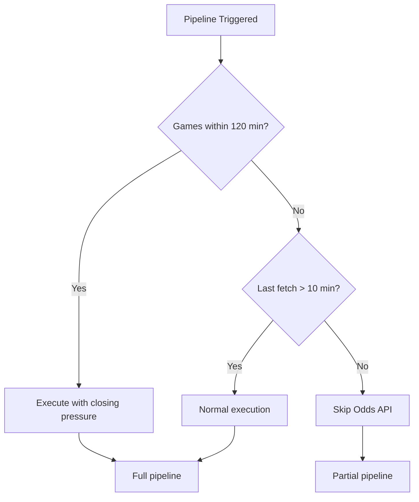

# Doctore AI – Technical Whitepaper

**Version 1.0 | January 2026**

---

## Executive Summary

Doctore AI is an automated sports betting edge detection system built on the philosophy of **"Fewer But Better Bets"**. The system identifies positive expected value opportunities by comparing sharp market prices against soft bookmaker odds, applying mathematical validation, and managing risk through fractional Kelly staking.

**Core Principles:**
- Mathematical edge validation over gut feeling
- Patience and discipline over volume
- Risk management over profit maximization

---

## System Architecture

### Pipeline Overview



### Pipeline Stages

| Stage | Function | Data Source | Output |
|-------|----------|-------------|--------|
| 1. ESPN Scrape | Game discovery | ESPN API | `games` table |
| 2. Odds API Fetch | Sharp market prices | The Odds API (Pinnacle) | `pinnacle_odds` table |
| 3. Execution Odds | Soft book prices | Veikkaus API | `execution_odds` table |
| 4. Fair Odds Calculation | Margin removal | Pinnacle odds | `fair_odds` table |
| 5. Decision Engine | Edge detection & validation | All tables | `edges` table |

---

## Mathematical Foundation

### 1. Fair Odds Calculation (Multiplicative Margin Removal)

Sharp bookmaker odds contain embedded margin. We remove this to derive true probabilities:

```
implied_probability = 1 / decimal_odds

overround = Σ(implied_probabilities)  // e.g., 1.03 = 3% margin

true_probability = implied_probability / overround

fair_odds = 1 / true_probability
```

**Example:**
```
Pinnacle odds: Home 2.10, Draw 3.40, Away 3.60
Implied probs: 0.476 + 0.294 + 0.278 = 1.048 (4.8% margin)
True prob (Home): 0.476 / 1.048 = 0.454
Fair odds (Home): 1 / 0.454 = 2.20
```

### 2. Edge Calculation

```
edge_percent = ((execution_odds / fair_odds) - 1) × 100
```

**Example:**
```
Veikkaus offers: 2.35
Fair odds: 2.20
Edge: ((2.35 / 2.20) - 1) × 100 = 6.8%
```

### 3. Fractional Kelly Criterion

```
implied_prob = 1 / fair_odds
kelly_full = (implied_prob × execution_odds - 1) / (execution_odds - 1)
stake_fraction = min(kelly_full × KELLY_FRACTION, MAX_STAKE_FRACTION)
```

**Parameters:**
- `KELLY_FRACTION = 0.25` (25% Kelly for variance reduction)
- `MAX_STAKE_FRACTION = 0.02` (2% bankroll cap per bet)

---

## Edge Lifecycle

### State Machine



### Transition Rules

| From | To | Condition |
|------|----|-----------|
| `new` | `confirming` | `snapshot_count >= 2` |
| `confirming` | `stable` | `consecutive_stable_runs >= 2` AND `confirm_span_minutes >= 30` AND `snapshot_count >= 3` |
| `stable` | `actionable` | `is_actionable = true` (all validation passed) |
| `*` | `decaying` | `edge_trend < TREND_NOISE_BAND` |
| `decaying` | `dead` | `edge_percent < BASE_MIN_EDGE` OR `last_seen > 60 min ago` |

---

## Configuration Parameters

### Edge Detection Thresholds

| Parameter | Value | Description |
|-----------|-------|-------------|
| `BASE_MIN_EDGE` | 3.5% | Minimum edge for consideration |
| `MIN_CONSECUTIVE_STABLE_RUNS` | 2 | Required consecutive stable pipeline runs |
| `MIN_CONFIRMATIONS_FOR_STABLE` | 3 | Required snapshot count |
| `MIN_SPAN_MINUTES_FOR_STABLE` | 30 | Minimum observation window |
| `TREND_NOISE_BAND` | -0.3 | Allowed negative trend before decay |

### Odds Filtering

| Parameter | Value | Description |
|-----------|-------|-------------|
| `MIN_ODDS` | 1.60 | Minimum acceptable odds |
| `MAX_ODDS` | 3.50 | Maximum acceptable odds |

### Risk Management

| Parameter | Value | Description |
|-----------|-------|-------------|
| `KELLY_FRACTION` | 0.25 | Kelly multiplier (25%) |
| `MAX_STAKE_FRACTION` | 0.02 | Maximum stake per bet (2%) |
| `MAX_TOTAL_EXPOSURE` | 0.05 | Total bankroll exposure cap (5%) |

---

## Database Schema



### Key Views

| View | Purpose |
|------|---------|
| `edges_public` | Public-facing edge data with game info |
| `edge_stats` | Aggregated edge statistics |
| `edge_clv` | Closing Line Value analysis |
| `pipeline_health` | Job monitoring dashboard |
| `source_performance` | Bookmaker/market performance |

---

## Risk Management

### Exposure Controls

1. **Per-Bet Cap**: Maximum 2% bankroll per individual bet
2. **Total Exposure**: Maximum 5% bankroll across all open positions
3. **Fractional Kelly**: 25% Kelly reduces variance while maintaining edge

### Source Blacklisting

Poor-performing bookmaker/market combinations are automatically flagged:

```sql
-- Blacklist criteria
avg_clv < -2.0 AND total_edges >= 10
```

### Trend Filtering

Edges with deteriorating value are excluded:

```
IF edge_trend < TREND_NOISE_BAND (-0.3):
    status = 'decaying'
    is_actionable = false
```

### Time-Based Trust

- Minimum 30 minutes observation window
- Minimum 3 snapshots before actionable
- 2 consecutive stable pipeline runs required

---

## API Rate Limiting

### The Odds API Strategy

| Condition | Action |
|-----------|--------|
| Last fetch < 10 minutes | Skip (unless closing pressure) |
| Game starting within 120 min | Force fetch (closing pressure) |
| Normal operation | 10-minute minimum interval |

### Subscribe Endpoint Protection

```
Rate limit: 5 requests per minute per IP
Storage: Database-backed (rate_limit_log table)
Cleanup: Automatic via scheduled function
```

---

## Pipeline Scheduling

### Dynamic Execution



### Closing Pressure Logic

When games are approaching start time, the system prioritizes fresh data:

```typescript
const closingPressure = upcomingGames.some(game => {
    const minutesToStart = (new Date(game.start_time) - now) / 60000;
    return minutesToStart <= CLOSING_PRESSURE_MINUTES; // 120 min
});
```

---

## Security & Access Control

### Row-Level Security (RLS)

All tables implement RLS policies:

| Table | SELECT | INSERT/UPDATE/DELETE |
|-------|--------|---------------------|
| `games` | Public | Service role only |
| `edges` | Public | Service role only |
| `pinnacle_odds` | Public | Service role only |
| `email_subscribers` | None | Service role only |

### Authentication

- Public read access for market data
- Service role authentication for data modification
- Rate limiting on public endpoints

---

## Appendix: Decision Engine Pseudocode

```typescript
function evaluateEdge(edge: Edge, game: Game): EdgeDecision {
    // 1. Basic filters
    if (edge.execution_odds < MIN_ODDS) return { actionable: false, reason: 'odds_too_low' };
    if (edge.execution_odds > MAX_ODDS) return { actionable: false, reason: 'odds_too_high' };
    if (edge.edge_percent < BASE_MIN_EDGE) return { actionable: false, reason: 'edge_insufficient' };
    
    // 2. Stability checks
    if (edge.consecutive_stable_runs < MIN_CONSECUTIVE_STABLE_RUNS) 
        return { actionable: false, reason: 'not_stable' };
    if (edge.snapshot_count < MIN_CONFIRMATIONS_FOR_STABLE) 
        return { actionable: false, reason: 'insufficient_confirmations' };
    if (edge.confirm_span_minutes < MIN_SPAN_MINUTES_FOR_STABLE) 
        return { actionable: false, reason: 'observation_window_short' };
    
    // 3. Trend validation
    if (edge.edge_trend < TREND_NOISE_BAND) 
        return { actionable: false, reason: 'negative_trend' };
    
    // 4. Calculate stake
    const stake = calculateFractionalKelly(edge);
    
    return { 
        actionable: true, 
        stake_fraction: stake,
        status: 'actionable'
    };
}
```

---

**© 2026 Doctore AI. All rights reserved.**

*This document is for informational purposes only. Past performance does not guarantee future results. Gambling involves risk.*